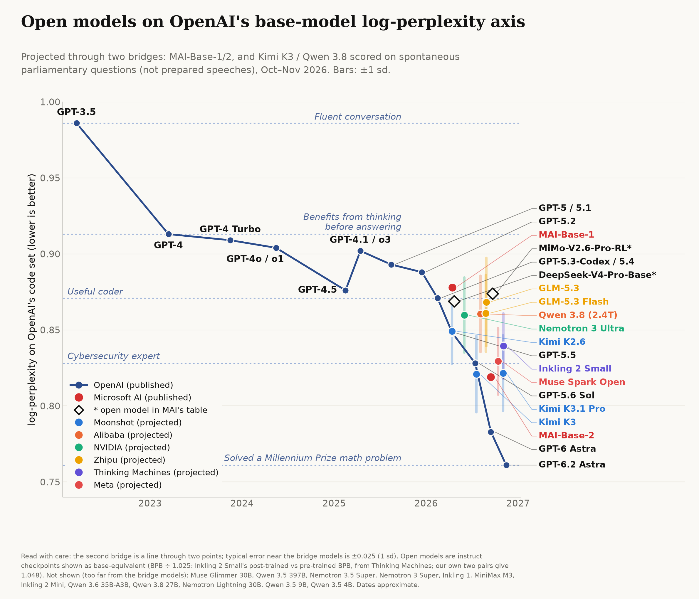
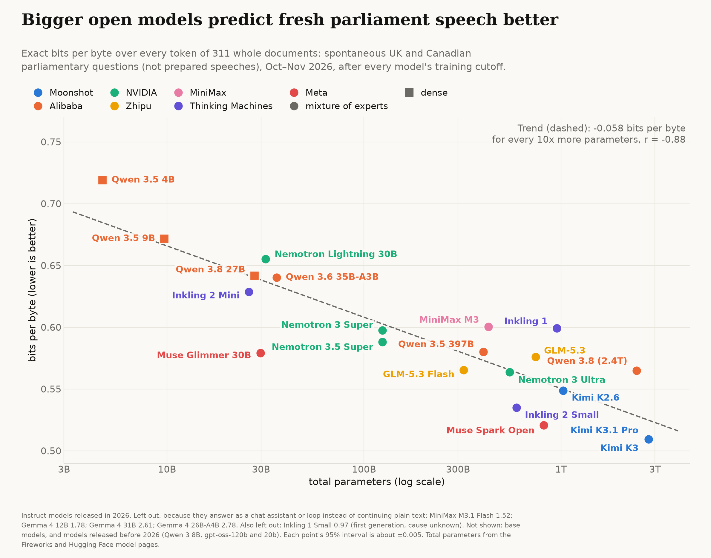

# Open models on OpenAI's perplexity chart

In November 2026 OpenAI published base-model log-perplexities for its own models, from GPT-3.5 to GPT-6.2 Astra,
on an internal code set. This repository places 2026's open models on the same chart.



## How

OpenAI's evaluation set is private, so the open models reach its axis through two bridges:

1. **Microsoft AI → OpenAI.** MAI-Base-1 and MAI-Base-2 have published scores both on OpenAI's set and on MAI's own
   held-out code set. A line through the two maps MAI's scale onto OpenAI's.
2. **Parliament speech → Microsoft AI.** Every open model is scored on fresh UK and Canadian House of Commons
   questions (Oct 1 – Nov 20, 2026). Kimi K3 and Qwen 3.8 are also in MAI's table, so a line through them maps this
   scale onto MAI's.

The text is spontaneous questions, not prepared speeches: off-the-cuff speech is not AI-written, and it comes after
every model's training cutoff, so no model can have seen it. Each model reads every document in full; the score is
the exact log-probability of every token, in bits per byte, so models with different tokenizers compare fairly.

Before any bridging, the measured scores alone show bigger open models predicting the text better:



Details, checks and caveats: [docs/method.md](docs/method.md).

## Read with care

- The second bridge is a line through two models. Near them the error is about ±0.025 on OpenAI's axis; models far
  from them are not placed. A model the bridge never saw (MiMo-V2.6-Pro) lands within that error.
- Most open models are instruct checkpoints, which predict plain text a little worse than their base models. Scores
  are corrected by the 2.5% gap Thinking Machines reported for Inkling 2 Small; the ranking does not depend on it.

## Reproduce

The per-document scores of every model are in `results/per_doc/`, so the charts need no API calls:

```bash
uv sync --extra plots
uv run python scripts/plot_openai_map.py --gpt35   # the chart above (add --vertical for a 3:4 version)
uv run python scripts/plot_params.py               # bits per byte against parameters
uv run python scripts/plot_mai_pairs.py            # agreement between MAI's four held-out sets
uv run python scripts/check_bridge.py              # the MiMo out-of-sample check
uv run python scripts/docs_report.py               # every model, with bootstrap intervals
```

Scoring again costs money and needs keys in `.env` (`FIREWORKS_API_KEY`, `TINKER_API_KEY`; Modal for the rest):

```bash
uv run cb corpus                       # fetch and sample the transcripts into data/corpus/truth/
uv run cb docs                         # plan only: models, documents, tokens
uv run cb docs --execute               # score on Fireworks and Tinker
uv run modal run scripts/modal_vllm.py --models <hf-repo>   # models no hosted API scores (vLLM on Modal)
uv run python scripts/rescore_anomalies.py                  # re-request documents a provider returned corrupted
uv run python scripts/export_per_doc.py                     # refresh results/per_doc/
```

## Layout

| Path | What |
|---|---|
| `src/cbridge/` | corpus fetching, whole-document scoring, the plain-text sanity check, the `cb` command |
| `scripts/` | Modal scoring, re-scoring, model metadata, report, charts, the bridge check |
| `configs/truth.yaml` | the corpus window, sampling and the models scored |
| `data/corpus/truth/fresh.jsonl` | the 391 transcripts (311 spontaneous questions, 80 prepared) |
| `data/anchors/` | OpenAI's published values and MAI's published tables |
| `results/per_doc/` | one CSV per model: bits and bytes for every document |
| `figures/` | the charts |
| `docs/literature/` | annotated reading lists |

Transcripts: UK House of Commons Hansard (Open Parliament Licence v3.0) and House of Commons of Canada debates via
openparliament.ca. Anchor values: OpenAI's "Perplexity and Intelligence" post; Microsoft AI's
[Frontier Pre-training](https://microsoft.ai/news/frontier-pre-training-at-microsoft-ai/) post and their November
2026 chart of MAI-Base-1/2 on OpenAI's set; Thinking Machines'
[Inkling 2 Small](https://thinkingmachines.ai/news/inkling-2-small/) post.
